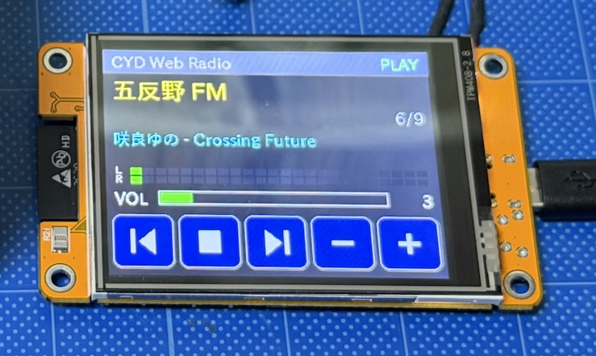

# CYD Web Radio (ESP32-2432S028R + PlatformIO)

## 使い方
1. VS Code で `cyd-webradio` フォルダを開く (PlatformIO IDE 拡張が必要)
2. `include/config.h` の `WIFI_SSID` / `WIFI_PASSWORD` を編集
3. スピーカーを CYD の `SPEAK` 端子 (P4, 1.25mm 2pin) に接続 *（画像はステレオ表示ですが、モノラルです）*
4. USB接続 → PlatformIO の Upload (→) → Monitor

## 操作 (タッチ)
`|<` 前の局 / 再生・停止 / `>|` 次の局 / `-` `+` 音量
最後に聴いた局と音量は保存されます。

## ラジオ局の設定
[Radio BrowserでJapanを検索](https://www.radio-browser.info/search?page=1&order=clickcount&reverse=true&hidebroken=true&countrycode=JP})
などで曲の名前とURLを試してみて、`include/config.h` の `const Station STATIONS[] ` の配列を書き換えます。

## トラブルシュート
| 症状 | 対処 |
|---|---|
| 画面の色が反転 | platformio.ini の `-DTFT_INVERSION_ON=1` を有効化 |
| 赤と青が逆 | `-DTFT_RGB_ORDER=TFT_BGR` を有効化 |
| タッチ位置がずれる | `main.cpp` の handleTouch() の map() 範囲を調整 |
| 音が小さい/歪む | 音量を 8〜12 程度に。内蔵DAC+小型アンプなので高音質ではありません |
| ノイズ(ジー音) | USB電源の品質、WiFi電波状況を確認 |
| 音が途切れる | 局のビットレートが高い場合は64〜128kbpsの局を選ぶ |
