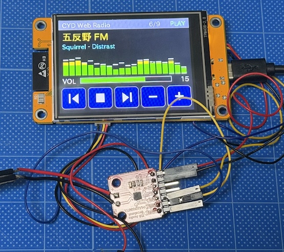

# CYD Web Radio (ESP32-2432S028R + PlatformIO)



# CYD Web Radio (ESP32-2432S028R + PlatformIO)

CYD (Cheap Yellow Display) と外付けI2Sアンプ (MAX98357A) で作る、インターネットラジオ。
日本語の局名・曲名表示、スペクトラム表示 (周波数分析)、タッチ操作つき。

- 音声出力: **MAX98357A (I2S)** で、クリアな音で再生できる (動作確認済み)
- 内蔵DAC (CYD のスピーカー端子) でも動くが、ノイズと歪みが残る (後述)

## 必要なもの
- CYD (ESP32-2432S028R)
- MAX98357A モジュールとスピーカー
- VS Code + PlatformIO IDE 拡張
- 2.4GHz の WiFi

## 配線 (MAX98357A)
配線は CYD の電源を切った状態で行う。

| MAX98357A | CYD | 備考 |
|---|---|---|
| BCLK | CN1 の IO27 | |
| LRC | CN1 の IO22 | P3 にも同じピンが出ている |
| DIN | P1 の TX (IO1) | UART0 のTXと共用 (下記の注意参照) |
| VIN | P1 の VIN (5V) | CN1 の 3V3 でも動くが、WiFi や ESP32 と電源を共用するため非推奨 |
| GND | P1 または CN1 の GND | |
| SD / GAIN | 未接続 | |
| 出力 (+ / −) | スピーカー | CYD の `SPEAK` 端子のスピーカーは外す |

基板の端子 (実機で確認済み):
- CN1: GND / IO22 / IO27 / 3V3
- P3: GND / IO35 / IO22 / IO21
- P1: VIN / TX / RX / GND

I2S の出力に使えるのは IO22 と IO27 の2本だけ。3本目 (DIN) には P1 の TX (IO1) を使っている。
IO35 は入力専用、IO21 はバックライトと共用なので使えない。

**注意:** IO1 は USB シリアルと共用のため、I2S モードではシリアルモニタに何も出ない (ログを自動で止めている)。
書き込みに失敗する場合は、DIN の配線を一度外して書き込み、終わったら付け直す。

## 使い方
1. VS Code で `cyd-webradio` フォルダを開く
2. `include/config.h` を編集する
   - `WIFI_SSID` / `WIFI_PASSWORD`: 自分の WiFi
   - `AUDIO_OUT_I2S`: **`1`** (MAX98357A を使う)
   - `STATIONS`: 聴きたい局 (局名は日本語も可)
3. USB 接続 → Upload → Monitor (I2S モードではログは出ない)

初回のビルドで、ライブラリの取得と `patch_audio.py` によるパッチ適用が行われる。
ビルドログに `[patch_audio] ... patched(4)` または `already` と出れば適用済み。
`ESP32-audioI2S が見つかりません` と出た場合は、もう一度ビルドする。

## ファイル構成
```
platformio.ini      ビルド設定 (env:cyd が本体 / env:noise_test は内蔵DACのノイズ診断用)
patch_audio.py      ライブラリに「再生前のプリバッファ」を追加するパッチ (platformio.ini と同じ場所に置く)
include/config.h    WiFi・局リスト・音量・出力方式などの設定
include/LGFX_CYD.h  液晶 (ILI9342系) の設定
src/main.cpp        本体
src/noise_test.cpp  ノイズ診断用 (内蔵DAC向け。シリアルモニタからキー操作)
```

## 画面の表示
- ヘッダー: タイトル / 局番号 / 再生状態
- 局名 (日本語可) と曲名 (2行まで)
- スペクトラム: 80Hz〜16kHz を対数の間隔で20本のバーに分けて表示 (ピークホールド付き)。
  モノラル音声 (L/R を混ぜたもの) を、音量を掛ける前に1024点のFFTで分析するので、音量を変えても表示は変わらない。
  表示の大きさは自動で調整され、高域は見やすいように持ち上げている (3dB/オクターブ)。
- 音量バー と 操作ボタン

## 操作 (タッチ)
`|<` 前の局 / 再生・停止 / `>|` 次の局 / `-` `+` 音量
最後に聴いた局と音量は、操作の3秒後に保存される。

## 主な設定 (`include/config.h`)
| 設定 | 値 (動作確認済み) | 内容 |
|---|---|---|
| `AUDIO_OUT_I2S` | 1 | 0: 内蔵DAC / 1: 外付けI2S (MAX98357A) |
| `I2S_BCLK` / `I2S_LRC` / `I2S_DOUT` | 27 / 22 / 1 | I2S のピン |
| `AUDIO_BUFFER_BYTES` | 40000 | 受信バッファ (約2.5秒分 @128kbps) |
| `AUDIO_PREBUFFER_BYTES` | 24000 | 再生を始める前に溜める量 (約1.5秒分) |
| `CPU_FREQ_MHZ` | 240 | 下げるとデコードが間に合わず「ブツブツ」が出ることがある |
| `VOLUME_MAX_DB` / `VOLUME_MIN_DB` | -6 / -50 (I2S時) | 音量21 / 音量1 の減衰量。大きすぎる場合は MAX を下げる (例: -12) |
| `DEFAULT_VOLUME` | 6 | 初期音量 (0〜21) |
| `ENABLE_SPECTRUM` | 1 | スペクトラム表示。音切れが多い場合は 0 を試す |
| `SCREEN_FLIP` | 0 | 画面の上下が逆なら 1 |
| `WIFI_TX_POWER` | 8.5dBm | つながりにくければ 11dBm / 15dBm に |
| `AUDIO_DITHER_MODE` | 3 | 内蔵DAC のときだけ有効 (I2S では使われない) |

液晶の設定 (`LGFX_CYD.h`): `CYD_PANEL 2` (ILI9342) / `invert = true` / `rgb_order = false`。
画面の色や向きがおかしい場合は、ここと `SCREEN_FLIP` を確認する。

## 局リストについて
- MP3 / AAC (LC) のストリームが再生できる。http 推奨 (https も動くが、暗号化でメモリを多く使う)。
- HE-AAC (AAC+) や、radiko / NHKらじる★らじる (認証付きHLS) は再生できない。
- 接続に失敗する局は、画面に `再接続中: HTTP/...` と出る。その局は無理に使わず、差し替える。
- 配信側が接続のたびに期限付きトークンを発行する局 (転送が3段になる局など) は、途切れやすい。

### ラジオ局の検索と追加
[Radio BrowserでJapanを検索](https://www.radio-browser.info/search?page=1&order=clickcount&reverse=true&hidebroken=true&countrycode=JP})
などで曲の名前とURLを試してみて、`include/config.h` の `const Station STATIONS[] ` の配列を書き換えます。


## わかったこと (トラブルシュート)
| 症状 | 原因と対処 |
|---|---|
| 音が途切れる | ライブ配信は実時間の速さでしか届かず、元のライブラリは溜めずに再生を始めるため。`patch_audio.py` のプリバッファで解消 |
| 音量に関係なく大きな「ブツブツ」 | デコードが間に合わず I2S が無音を出している。`CPU_FREQ_MHZ` を 240 に |
| 音が出ない (I2S) | 配線 (特に BCLK と LRC の取り違え)、`AUDIO_OUT_I2S` が 1 か確認。`0` に戻すとログが見られる |
| 書き込みに失敗する | DIN (P1 の TX) の配線を一度外して書き込む |
| 音が大きすぎる | `VOLUME_MAX_DB` を下げる |
| 画面の色・向きがおかしい | `LGFX_CYD.h` の `invert` / `rgb_order` / `CYD_PANEL`、`config.h` の `SCREEN_FLIP` |
| 局に繋がらない | 配信側の制限。別の局に差し替える |

## 内蔵DAC (CYD のスピーカー端子) で使う場合
`AUDIO_OUT_I2S` を `0` にすると、内蔵DAC (GPIO26) から出力する。この場合は次の制約がある。
ノイズや歪みを減らす工夫はしてあるが、**実用的とまでは言えない**。

- 内蔵DACは8bitで、音量を下げるほど量子化のざらつきが出る。`AUDIO_DITHER_MODE 3` (ノイズシェーピング) で大幅に改善。
- WiFi 接続時に、一定の高さの「ピー」音が出る (基板の電源・回路由来で、ソフトでは直せない)。
  `CPU_FREQ_MHZ` を下げると小さくなるが、デコードが間に合わなくなる可能性がある。
- `AUDIO_DITHER_MODE` の 1, 2 (ディザ) は、無音でも雑音が出るので使わない。
- DAC の中心レベルを変えると、アンプが誤動作して大きな雑音が出る (試さないこと)。
- ステレオの局は、L/R を混ぜたモノラルで出力される。
- 内蔵DACのモードでは、シリアルモニタで詳細なログ (`buf`、`RSSI` など) が見られる。

### ノイズ診断
`env:noise_test` を書き込み、シリアルモニタでキーを送ると、DAC を無音に固定したまま、
画面更新・WiFi・CPU負荷・WiFi設定・CPUクロック・DACレベルを1つずつ切り替えて、ノイズの原因を切り分けられる。
診断が終わったら、ステータスバーで `env:cyd` に戻すこと。
らに音質を上げたい場合
内蔵DAC (8bit) とアンプの限界があるため、根本的な改善には外付けのI2S DAC/アンプ (MAX98357A など) が必要。
`config.h` の `AUDIO_OUT_I2S` を 1 にし、`I2S_BCLK` / `I2S_LRC` / `I2S_DOUT` を実際に引き出せるピンに合わせる。
